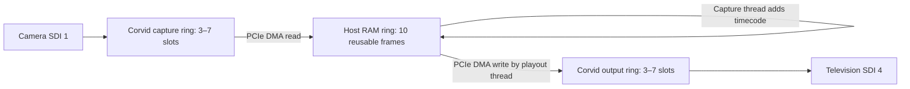

# Live SDI buffering

The SDI test has three separate storage areas, not one seven-frame queue:

## Device capture ring

AutoCirculate writes incoming frames to dedicated frame stores in the Corvid's
SDRAM. The capture thread transfers available completed frames into RAM. Our
video-only path reads when at least one completed frame is available. The SDK's
two-frame predicate remains in use when audio is enabled, because it protects
the audio write head. The previous unconditional two-frame predicate caused
regular capture drops with three device slots in the isolated live retest.
If capture cannot drain the ring in time, the input drop counter increases.

## Host RAM ring

The SDK allocates ten `NTV2FrameData` entries at initialization. Their video
storage is page-aligned and DMA-locked by the SDK. The capture thread reserves
a free entry, DMA-reads the video, draws the timecode, and publishes that entry
to the circular buffer. The playout thread consumes it in order, DMA-writes it
to the card, then returns the entry for reuse. This is a FIFO producer/consumer
ring, not a newest-frame replacement pool. Ten is capacity, not a mandatory
ten-frame wait. The same host frame is reused by both threads; there are not
separate ten-frame input and output RAM pools.

At 1920×1080, packed 8-bit YCbCr 4:2:2 contains roughly 4.15 MB per image;
ten host images take about 41.5 MB, plus alignment and metadata. Audio and
ancillary buffers are disabled in the current test.

## Device output ring

The playout thread queues host frames into a separate region of card SDRAM.
The SDK reserves one slot when deciding whether another output frame can be
accepted. With three slots, startup therefore waits for two frames; with four
through seven slots, startup waits for three. The device sends queued frames
to SDI at the output clock rate. When it runs out of ready frames, the output
drop counter reports underruns. The clock is currently free-running, as in
the SDK example, rather than locked to an external reference.

## Capacity, occupancy and latency

Capacity is the maximum allocated storage. Occupancy is the amount currently
buffered. The UI and CSV report the two device occupancies and capacities;
host occupancy is tracked by frame ownership stage (capture, ready, output),
with a run peak. Concurrent stage snapshots near transitions are approximate.
At 50 FPS
a frame period is 20 ms. Multiplying slot count by 20 ms describes storage
in frame periods, not measured camera-to-TV latency. Capture gating, startup
prefill, live queue occupancy, DMA/CPU work and the TV all affect that latency.

Reducing the maximum device counts can reduce accumulated backlog but does
not by itself force empty queues or remove all SDK pipeline delay. The 10-slot
host FIFO can still accumulate older frames under load. True latency tuning
will also need a camera-to-display measurement; host occupancy alone is not
a complete latency measurement.

## Separate synthetic compositor

`compositor_demo` still uses the original `FramePool` implementation: three
RGBA8 surfaces each for synthetic camera, synthetic scene and composite output
(nine surfaces total). Exclusive write leases and shared read leases protect
storage; producers can replace the oldest unleased publication. The scheduler
selects recent frames by timestamps. That system is not connected to the live
AJA SDI test yet, and it does not add another nine buffers to this SDI path.

## Live comparison on October 13, 2026

Corvid44-12G-8K, 1080p50a input SDI 1, output SDI 4, video only.
Counts include startup. These are short baseline runs, not latency measurements
or a guarantee of behavior under a production workload.

| Input / output slots | Duration | Captured | Output processed | Input drops | Output drops |
|---|---:|---:|---:|---:|---:|
| 3 / 3 | 30.233 s | 961 | 949 | 548 | 557 |
| 4 / 4 | 30.004 s | 1222 | 1209 | 276 | 285 |
| 7 / 7 | 30.248 s | 1510 | 1506 | 0 | 0 |
| 3 / 7 | 10.262 s | 341 | 339 | 170 | 167 |
| 7 / 3 | 10.257 s | 335 | 319 | 176 | 188 |

The 7/7 run sampled input occupancy between 1 and 2 and output occupancy
between 2 and 3, despite the seven-slot allocations. The smaller asymmetric
tests also dropped frames; neither demonstrated a reliable smaller setting
for the implementation at that time. Seven was kept as the default pending
the profiling investigation below.

The profiling work subsequently identified a missing subscription to the
actual output frame store's vertical interrupt and the inappropriate audio
capture threshold in this video-only test. The smaller-ring tests above predate
those fixes. Four buffers per direction are now the default. See
[SDI_PROFILING.md](SDI_PROFILING.md) for the measured cause and the retest.

Raw CSV files in `output`, in the table's order:

- `sdi-17918895512060857.csv`
- `sdi-17918895816049633.csv`
- `sdi-17918896117529696.csv`
- `sdi-17918896670662720.csv`
- `sdi-17918896775093742.csv`

Source: the pinned local AJA SDK 18.0.0 `ntv2burn.cpp`, `ntv2democommon.h`,
and `ntv2publicinterface.h`, plus this project's `src/sdi_test_win.cpp`.
