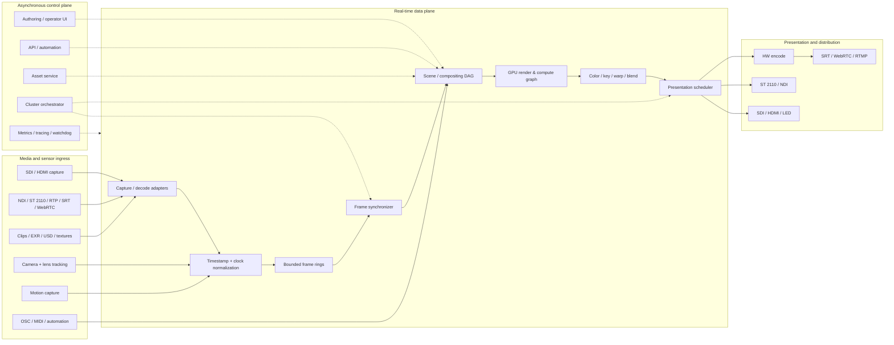
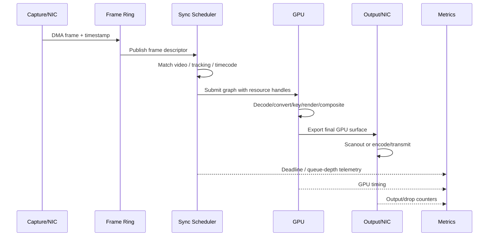
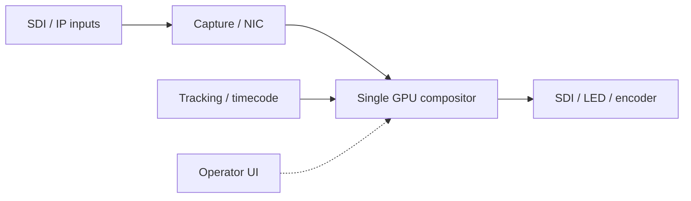
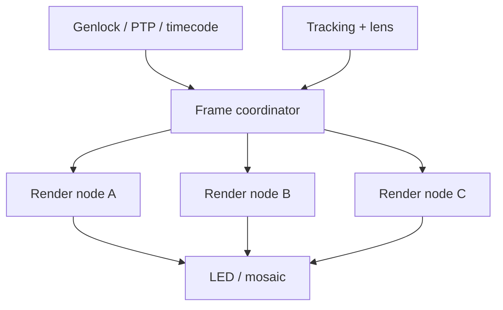

# Real-Time Compositing Software Architecture: Systems, Patterns, Performance, and Technology Choices

## Executive summary

Real-time compositing is best understood not as “compositing that happens quickly,” but as **deadline-bound image synthesis**: one or more live or generated image sources, tracking/control signals, graphics layers, and often audio must be acquired, synchronized, transformed, blended, rendered, and delivered before the next presentation deadline. At 60 Hz that deadline is 16.67 ms; at 50 Hz it is 20 ms; at 30 Hz it is 33.33 ms. Broadcast and LED-volume virtual production are therefore closer to soft/hard real-time systems engineering than to conventional offline VFX. Unreal Engine makes this distinction explicit through genlock and nDisplay frame synchronization; TouchDesigner exposes input synchronization and even a mode that stalls execution until a capture frame arrives; Disguise distributes camera, image, metadata, and control state across RenderStream nodes. citeturn22view11turn22view12turn18view2turn22view3

Across the systems studied, four architectural families emerge:

| Architectural family | Representative systems | Architectural center of gravity |
|---|---|---|
| **Render-engine centric** | Unreal Engine, Unity | A real-time 3D renderer with compositing, media, shader and scripting subsystems around it |
| **Graph-centric media/VFX** | Nuke Stage, Notch, TouchDesigner | A procedural DAG/node graph in which images, geometry, data and controls are evaluated incrementally |
| **Broadcast graphics / production** | Viz Engine, Ross XPression, OBS Studio | Sources/scenes/templates → real-time renderer/compositor → keyed/fill or encoded outputs |
| **Orchestration-centric** | Disguise RenderStream, custom distributed systems | Control, tracking and frame distribution separated from one or more external render engines |

The most consequential design choice is usually **not the shader language or engine**. It is where buffers cross device, process, and machine boundaries. A 3840×2160 RGBA8 frame is about 31.6 MiB; at 60 fps a single full-frame path moves roughly 1.99 GB/s before accounting for extra copies. A capture → CPU → staging → GPU → readback → encoder architecture can therefore become memory-bandwidth- and PCIe-bound long before shader ALU capacity is exhausted. TouchDesigner documents this directly: its pinned-memory path reduces capture-to-GPU transfer from three copies to two, while NVIDIA GPUDirect technologies are specifically designed to bypass system-memory copies and, in applicable configurations, let I/O or networking devices access GPU memory directly. citeturn18view2turn21search3turn21search15turn21search19

The most robust architecture is consequently a **two-plane design**:

**The real-time data plane** owns capture, frame queues, synchronization, GPU resources, graph evaluation, compositing, presentation and encoding. It is bounded, preallocated where practical, back-pressure-aware, and isolated from unpredictable operations.

**The control plane** owns scene editing, automation, asset management, configuration, orchestration, telemetry and remote APIs. It may use conventional asynchronous service architecture because a delayed telemetry packet should never make the video render thread miss vsync.

This separation is visible in different forms across the market. Disguise separates its orchestration environment from content engines over RenderStream; OBS separates sources, scenes, encoders, outputs and services in `libobs`; Unreal separates Media Framework, renderer/Composure and nDisplay synchronization; Nuke Stage separates its node-based creative environment from scalable render-node execution. citeturn22view3turn17search6turn22view13turn8view0

For **broadcast and high-end virtual production**, the preferred architecture is a GPU-resident pipeline using professional capture or ST 2110 ingress, hardware time synchronization/genlock, persistent GPU resources, asynchronous DMA, GPU compositing, and direct hardware output. Unreal's AJA/Blackmagic/Rivermax integration and nDisplay synchronization represent this pattern particularly clearly. citeturn22view11turn22view12turn22view13

For **creative live VFX and installations**, TouchDesigner and Notch are architecturally attractive because their visual graphs expose the media/data pipeline directly. TouchDesigner offers unusually explicit control over capture transfer strategy and synchronization, while Notch combines a node graph, GPU-native processing and a rendering architecture designed for media-server execution. citeturn18view0turn18view2turn22view5turn22view6turn22view7

For **large LED/virtual-production stages**, Disguise is less a competing renderer than an orchestration fabric: RenderStream distributes tracking, frames, metadata and control to engines including Unreal, Unity, Notch and TouchDesigner. Foundry is approaching the same problem from the compositing/VFX side with Nuke Stage, which adds real-time LED-wall playback, camera-tracking integrations, open formats and synchronized render clusters to the Nuke family. citeturn22view3turn8view0

For **internet streaming**, OBS is the clearest reference architecture because `libobs` is open and explicitly decomposed into sources, scenes, graphics, encoders, outputs and services. Its goals differ from a genlocked broadcast compositor, however: encoding, muxing and network delivery are first-class concerns, whereas deterministic SDI/ST 2110 frame locking is not the architectural center. citeturn17search6turn17search10turn17search21

A custom engine becomes justified when a project needs combinations the packaged products do not provide: sub-frame or one-frame bounded latency, unusual sensor fusion, embedded hardware, very high channel counts, deterministic failover, custom GPU kernels, direct RDMA, or cloud/edge distribution. The cost is that synchronization, color management, buffering, device-loss recovery, codecs, telemetry and interoperability—all mature subsystems in the commercial products—become engineering responsibilities.

A critical caveat applies to any comparison of “latency.” The reviewed vendors generally do **not** publish standardized, independently comparable glass-to-glass latency measurements covering capture, processing, output, display and networking. Accordingly, this report uses **latency posture**—frame-synchronous, interactive, buffered/network-oriented, etc.—rather than inventing misleading millisecond figures.

## Scope, use cases, and real-time requirements

A useful formal model is:

\[
T_\text{capture}+T_\text{queue}+T_\text{sync}+T_\text{decode}+T_\text{graph}+T_\text{render}+T_\text{copy}+T_\text{output}
\leq T_\text{frame}
\]

and, for an interactive remote system:

\[
T_\text{interaction}
=
T_\text{capture}
+T_\text{uplink}
+T_\text{process}
+T_\text{encode}
+T_\text{network}
+T_\text{decode}
+T_\text{display}
\]

The first equation is the important one for SDI, ST 2110, AR graphics and LED volumes. The second dominates cloud rendering and WebRTC/SRT workflows.

A system should count as **real-time compositing** when its principal output is evaluated continuously against a presentation clock and current inputs, rather than being rendered opportunistically into an offline sequence. The compositor may be explicit—a Nuke-, Notch- or TouchDesigner-style node graph—or implicit inside a scene/renderer, as in Unreal, Unity, Viz Engine or XPression. Nuke itself is traditionally a node-based image-processing compositor; Foundry's newer Nuke Stage specifically brings the family into real-time LED-wall playback and virtual-production workflows. citeturn7view0turn8view0

There are several useful real-time classes:

| Class | Deadline behavior | Examples | Primary failure when overloaded |
|---|---|---|---|
| **Frame-synchronous production** | Output must line up with facility/video clock | Broadcast graphics, SDI compositing, LED volumes | Dropped/repeated/misaligned frames |
| **Low-latency interactive** | Fast response is more important than phase-locking | Live VFX, installations, previs | Increasing interaction latency |
| **Game-engine real time** | Must sustain target display refresh | Unreal, Unity applications | Dynamic-resolution/quality reduction or frame drops |
| **Streaming real time** | Encode/network buffering is accepted | OBS, SRT/RTMP contribution | Buffer growth, congestion or dropped packets |
| **XR real time** | Motion-to-photon deadline and pose freshness dominate | AR/VR | Motion sickness, pose error, reprojection artifacts |

This distinction matters because a system that renders 120 fps in isolation can still be unsuitable for a television studio if it cannot lock its frame production to the incoming reference. Epic explicitly distinguishes ordinary timecode assignment from genlock, in which Unreal produces one engine frame for each incoming reference/video frame; nDisplay further combines genlock with frame-locking among multiple machines. citeturn22view11turn22view12

**Broadcast** workloads combine live video, keyed graphics, data feeds, clips, lower thirds, virtual sets and AR, usually under a house timing reference. The priorities are deterministic frame cadence, fill/key correctness, redundancy and immediate operator control. Viz Engine is explicitly positioned around real-time 3D rendering, compositing, video playout, virtual sets, synchronized video walls and data-driven overlays, while Ross XPression centers on real-time motion graphics and multi-engine sequencing/control. citeturn22view1turn22view0

**Virtual production** adds tracked cameras, lens metadata, LED walls and often multi-machine rendering. Here a correct-looking but old frame is still wrong: camera pose, perspective and LED scanout must correspond closely enough in time that the photographed wall behaves like a physical environment. Unreal's nDisplay and timecode/genlock stack, Disguise RenderStream and Nuke Stage's tracking/render-node architecture all address portions of this problem. citeturn22view11turn22view12turn22view3turn8view0

**Live VFX and events** prioritize authorability, parameterization and unusual signal interactions. Notch exposes a visual node graph and GPU-focused renderer; TouchDesigner exposes procedural operators with live per-node visualization and is designed to remain editable while running. citeturn22view5turn22view6turn18view0

**Game-engine compositing** merges physically based 3D rendering with cameras, media textures, shaders and post-processing. Unity HDRP, for example, is a Scriptable Render Pipeline supporting forward and deferred rendering and compute-shader-based graphics; Unreal combines its renderer with Media Framework, Composure and nDisplay. citeturn22view10turn22view13turn2search0

**AR/VR** is a special case because scene compositing and tracking are coupled to the display's pose and refresh cycle. Techniques such as late pose sampling, foveated rendering, dynamic resolution and reprojection are generally much more valuable here than in a conventional broadcast lower-third renderer.

Target platform choice changes the architecture materially:

| Platform | Architectural implications |
|---|---|
| **Desktop/workstation** | Best environment for integrated authoring plus rendering; direct access to capture cards and discrete GPUs; simplest low-latency topology |
| **Render/server node** | Headless or minimally interactive operation; remote control; watchdogs; deterministic startup; redundant power/networking; often multiple GPU/NIC/capture resources |
| **Cloud GPU** | Excellent elasticity and remote collaboration, but WAN jitter makes facility-level genlock impractical across arbitrary Internet paths; encode/network pipelines become mandatory |
| **Edge/hybrid** | Keep capture, tracking and final render near the stage while moving asset management, control, collaboration and distribution to cloud services |
| **Embedded/SoC** | Fixed memory/thermal budget, usually hardware codecs and integrated GPU; favors Vulkan/Metal-class APIs, static allocation and a smaller plugin surface |

Notch, for example, publicly targets high-performance Windows x86-64 GPU machines, whereas Unity and Unreal cover a much broader set of deployment targets. TouchDesigner's architecture is oriented to interactive workstations and display systems, while its video I/O documentation directly integrates professional Blackmagic, AJA, Deltacast and Bluefish devices. citeturn22view5turn22view10turn18view2

## Reference architecture, data flow, synchronization, and protocols

A modern compositor should be regarded as a **stream-processing system whose records happen to be image frames, audio blocks and sensor samples**.



The central rule is that the dashed-line control-plane interactions should **never be allowed to block the solid real-time path**. Loading an asset, doing DNS, writing a log, resizing a container, resolving a remote service or performing garbage collection at the wrong moment can be more damaging than an expensive shader.

### Frame lifecycle

A well-designed frame is normally processed as a sequence of bounded ownership transfers:



The important word is **descriptor**. Ideally, a stage passes handles to an already allocated surface rather than allocating and copying an image again.

TouchDesigner makes the cost of this distinction unusually concrete. Its Video Device In TOP offers pre-upload and on-demand GPU transfers, pinned versus ordinary CPU memory, multi-input synchronization, and an AJA-specific mode in which TouchDesigner waits for an incoming frame before beginning evaluation. Its documentation says pinned memory reduces the path from three copies to two; synchronized inputs assume sources themselves are genlocked. citeturn18view2

At the more aggressive end, NVIDIA GPUDirect RDMA lets supported PCIe devices access GPU memory without routing the payload through normal CPU buffers, while GPUDirect Storage similarly supplies a direct DMA path between storage and GPU memory. GPUDirect for Video exists specifically to reduce the copy/synchronization overhead between professional I/O devices and GPUs. citeturn21search3turn21search15turn21search19

### Media, control and synchronization protocols

No single protocol is appropriate for every link:

| Interface | Architectural role | Typical placement | Latency / buffering implications |
|---|---|---|---|
| **SDI** | Professional baseband video, often including embedded timecode | Camera/capture-card ↔ compositor ↔ switcher | Excellent local determinism; bandwidth/cabling scale physically |
| **ST 2110-class IP** | Facility-scale professional media over managed IP | Studio network ↔ render nodes | Designed for synchronized media infrastructure; requires disciplined network/timing design |
| **NDI** | Discoverable IP audio/video/metadata | LAN production and creative tools | Easier deployment than facility uncompressed IP; network load and codec mode matter |
| **RTP** | Real-time media packet transport substrate | Managed or application-specific IP media | Low overhead but application must handle timing/loss semantics |
| **SRT** | Reliable, encrypted low-latency contribution over unreliable networks | Site ↔ cloud/remote site | Trades configured latency for retransmission opportunity |
| **RTMP** | Streaming contribution/distribution | Encoder → streaming service | Widely interoperable, but normally not the right primitive for a frame-synchronous render loop |
| **WebRTC** | Interactive real-time media/data | Browser/mobile/remote operator/client | Excellent for interactive cloud rendering; WAN jitter remains variable |
| **OSC** | Structured real-time parameter/control messages | Console/sensors → graph parameters | Lightweight control; do not treat as trusted Internet API |
| **MIDI** | Event/controller data | Musical/control devices → compositor | Very small control payload; independent of video timing unless explicitly correlated |
| **GPU texture/buffer handle** | In-process or cross-API frame exchange | Renderer ↔ compositor ↔ encoder | Lowest-copy option when APIs can share resources |
| **Shared memory** | Cross-process local exchange | Engine process ↔ compositor process | Low overhead but needs explicit ownership/fence protocol |
| **RenderStream** | Disguise's engine orchestration transport | Disguise ↔ render engines/nodes | Exchanges tracking, frames, metadata and controls bidirectionally |

NDI describes itself as an IP video standard for discovery and communication of low-latency, frame-accurate audio/video and metadata. SRT is a UDP-based protocol adding reliability, latency-aware loss recovery and encryption for live media transport. Unity's official WebRTC package underlies its higher-level Render Streaming package. citeturn14search2turn19search3turn22view9

Professional capture remains particularly important. Unreal Media Framework exposes separate AJA, Blackmagic and Rivermax media sources, with Rivermax used for SMPTE 2110 workflows; Unreal's timecode/genlock support can source timing from AJA or Blackmagic SDI paths. TouchDesigner likewise integrates Blackmagic, AJA, Deltacast and Bluefish capture devices and can extract embedded timecode from supported devices. citeturn22view13turn22view12turn18view2

A good internal timestamp model should normalize all externally timestamped events—video frames, tracking poses, lens data, mocap and audio—to one monotonic timeline. **Timecode identifies a frame; genlock controls when a frame is produced.** Confusing those two is a frequent architectural error. Unreal's documentation demonstrates the distinction directly: it can adopt external timecode independently, or additionally use a custom time step so the engine produces one frame per incoming reference frame. citeturn22view12

## Existing systems and their architectures

Public documentation varies dramatically in depth. OBS exposes its implementation because the source is open. TouchDesigner documents low-level transfer modes. Unreal publishes substantial synchronization and media-I/O documentation. At the other end, Vizrt and Ross primarily publish product/workflow architecture rather than renderer thread, allocator or queue internals. A rigorous comparison therefore has to distinguish **documented internals** from architectural inference rather than pretending every vendor exposes the same level of detail.

| System | Public architecture / diagram emphasis | Core compositing model | Media and synchronization | Main integration model |
|---|---|---|---|---|
| **Unreal Engine** | Media Framework + Composure + nDisplay cluster/sync topology | Scene renderer, materials/shaders, post-process and compositing passes | AJA, Blackmagic, Rivermax/ST 2110; timecode, genlock, frame-lock | C++, Blueprint, plugins, tracking/capture hardware citeturn2search0turn22view11turn22view12turn22view13 |
| **Unity** | Scriptable Render Pipeline/HDRP, Shader Graph/VFX Graph, WebRTC/Render Streaming | Real-time scene/render pipeline with programmable render passes | WebRTC first-party package; professional media I/O generally plugin/native-SDK oriented | C#, native plugins, packages, shaders citeturn3search0turn22view10turn22view9 |
| **Nuke / Nuke Stage** | Nuke DAG plus Stage LED/render-node workflow | Node-based image processing; Stage adds real-time VP toolset | EXR/NotchLC playback, tracking metadata, synchronized clusters | Python, C++ SDK, BlinkScript; UnrealReader/Nuke Server bridge citeturn7view0turn8view0turn5search7 |
| **Notch** | Node hierarchy/data-flow and NURA rendering architecture | GPU-centric node graph spanning 2D, 3D, particles and post-FX | Live video/audio, OSC/MIDI, tracking, media-server/render-node operation | Nodes, custom shaders, Blocks, media-server integration citeturn22view5turn22view6turn22view7turn22view8 |
| **Viz Engine** | Broadcast rendering/compositing/playout workflow | Real-time 3D + video + data compositor; vendor says final composite can be generated in one pass | Broadcast I/O/configuration dependent; synchronized walls and production workflows | Viz ecosystem, data, Unreal integration, Graphic Hub citeturn22view1turn21search21turn21search27 |
| **Ross XPression** | Graphics/rundown/multi-engine workflow | Real-time motion-graphics scenes and sequenced playout | Broadcast appliance ecosystem; facility interfaces vary by configuration | Sequencer, Remote Sequencer, data and Ross production ecosystem citeturn22view0 |
| **Disguise** | RenderStream architecture/topology | Orchestration rather than one fixed renderer | Proprietary bidirectional RenderStream carrying images, tracking, metadata and parameters | Unreal, Unity, Notch, TouchDesigner and RenderStream SDK/plugins citeturn22view3turn13search6 |
| **TouchDesigner** | Operator graph and explicit I/O/data-flow documentation | Procedural TOP/CHOP/SOP/DAT/operator graph | SDI capture, NDI, timecode, genlocked multi-input sync, frame-lock | Python, GLSL, plugins, capture/tracking/control operators citeturn18view0turn18view2turn18view3turn18view5 |
| **OBS Studio** | `libobs` backend/object architecture; source code | Sources → scenes/filters → renderer → encoder/output | Streaming/recording oriented; protocol/output functionality modular | C plugin API, Lua/Python scripts, WebSocket, service/output modules citeturn17search6turn17search18turn17search33 |
| **Custom engine** | Defined by engineering team | Usually DAG/render graph + dedicated I/O adapters | Arbitrary SDI/ST2110/NDI/SRT/WebRTC/etc. | Full source/API ownership |

**Unreal Engine.** Unreal's real-time-compositing architecture is a collection of cooperating subsystems rather than one compositor process. Media Framework abstracts media sources and players; professional inputs include AJA, Blackmagic and Rivermax. Composure provides layered compositing for virtual production. The normal real-time renderer performs scene, material, lighting and post-process work, while nDisplay distributes rendering across display/render nodes. Timecode providers and custom time steps connect engine cadence to external reference, and nDisplay combines genlock with GPU/frame synchronization across cluster machines. Epic's documented synchronization topology is therefore one of the clearest commercial examples of the reference architecture above. citeturn2search0turn22view11turn22view12turn22view13

For latency-sensitive Unreal deployments, the important boundary is typically **capture surface → Media Texture/render resource → GPU composite → nDisplay/output**, not Blueprint execution itself. AJA/Blackmagic are appropriate at SDI edges; Rivermax addresses professional IP media. An architectural risk is that Unreal remains a general game engine: streaming, world simulation, asset loads, garbage collection, shader compilation and editor activity must be prevented from perturbing the presentation-critical path. That is a design conclusion from its much broader runtime responsibilities, rather than an Epic claim.

**Unity.** Unity has a similar render-engine-first architecture but makes render-pipeline customization particularly explicit through the Scriptable Render Pipeline. HDRP supports forward and deferred rendering and uses compute-shader technology; Shader Graph and VFX Graph supply graph-based authoring at the shader/effects layer. Unity also provides an official WebRTC package, which its Render Streaming package uses as a lower-level transport. citeturn3search0turn22view10turn22view9

Unity is therefore strong when “compositing” is inseparable from an interactive application, XR experience or generated 3D scene. In contrast with Unreal's heavily documented professional Media Framework/AJA/Blackmagic/Rivermax path, a broadcast-specific Unity deployment generally depends more heavily on native plugins, partner integrations or custom hardware SDK work. Architecturally this makes Unity very extensible, but places more responsibility for genlock, capture queues and device-specific zero-copy paths on the integrator.

**Foundry Nuke and Nuke Stage.** Classic Nuke remains a large node-based image-processing system—Foundry documents more than 200 nodes, OpenEXR/USD/OpenColorIO/ACES support, Python/PySide, a C++ SDK and BlinkScript—but it should not be conflated with a conventional genlocked broadcast compositor. citeturn7view0

Nuke Stage is the relevant real-time product. Foundry describes it as hardware-agnostic real-time playback for LED walls, with native NotchLC and B44 EXR playback, ACES/OCIO/HDR color, USD-based scenes, node-based real-time tools, tracking integrations including Vicon, Mo-Sys and OptiTrack, captured lens/camera/timecode metadata, and synchronization across render-node clusters. This makes its architecture conceptually attractive to VFX organizations because the offline and stage domains share Nuke-family concepts and color/assets rather than forcing everything through a game-engine-specific creative model. citeturn8view0

UnrealReader is a separate architectural bridge: Nuke communicates with an Unreal instance through the Nuke Server plugin over TCP/IP and can synchronize its timeline while receiving Unreal-generated pixels/passes. It is useful for interactive VFX workflows, but should not be confused with the hard frame-synchronous LED-stage role of Nuke Stage. citeturn5search3turn5search7

**Notch.** Notch is architecturally closer to a GPU-native real-time VFX graph than to a traditional broadcast template engine. Its public material describes a node-based workflow, native GPU acceleration, a unified rendering architecture known as NURA, live media/control inputs, render nodes and media-server integration. The manual separately documents node hierarchy/data flow and multi-machine determinism—important evidence that deterministic distributed playback is an explicit design concern. citeturn22view5turn22view6turn22view7turn22view8

The practical consequence is that Notch tends to keep effects—particles, procedural geometry, lighting, post-processing and image manipulation—inside one real-time execution environment. This minimizes the impedance mismatch between a “VFX compositor” and a “3D renderer.” Blocks can then be hosted by media-server environments rather than requiring the whole authoring application to become the production orchestration layer. Notch's public documentation also exposes OSC/MIDI, live video/audio and multiple tracking-related nodes, making it particularly strong for live events and sensor-driven content. citeturn11view0turn22view5

**Viz Engine.** Viz Engine is a broadcast-first real-time 3D renderer/compositor. Vizrt describes a pipeline that renders video, graphics and data into a final composite in a single pass, and targets virtual sets, AR, synchronized video walls, overlays and video playout. Viz Engine also depends on surrounding Viz infrastructure such as Graphic Hub, and current Viz workflows include a deeper Unreal integration so Unreal content can participate in established broadcast control workflows. citeturn22view1turn21search21turn21search27

The significant architectural distinction from Unreal itself is **operational orientation**: Viz is designed around broadcast graphics lifecycle, data and playout rather than around a general world/game runtime. Viz Engine 5.5, released in February 2026, also advertises frame-aligned web-channel rendering and updated web technology, demonstrating how browser-rendered graphics are increasingly becoming another input/render subsystem inside broadcast graphics engines. citeturn22view2

Vizrt does not publicly expose renderer threading, allocator topology or command-queue implementation at OBS-like source-code detail. Those details should therefore be treated as vendor internals, not reverse-engineered assumptions in an architecture specification.

**Ross XPression.** XPression occupies a similar broadcast-graphics category but emphasizes scene/template production, sequencing and coordinated multi-engine operation. Ross documents a Remote Sequencer that can control multiple XPression engines and a Sequencer Gateway that consolidates rundown creation/layout across channels and systems; the wider Ross infrastructure includes timing, signal-processing and ST 2110/AES67 gateway products. citeturn22view0

That surrounding ecosystem matters: professional broadcast compositing is rarely a single executable. Graphics engines sit among automation, switchers, key/fill paths, databases, tally, timing and distribution. XPression's public material is consequently much more workflow/appliance oriented than thread/allocator oriented. It would be unsafe to infer that every protocol advertised elsewhere in the Ross portfolio terminates directly inside every XPression configuration; actual I/O should be validated SKU-by-SKU.

**Disguise.** Disguise is architecturally unusual because RenderStream explicitly separates the **render-engine concern from the show-orchestration concern**. RenderStream's bidirectional protocol exchanges camera tracking, rendered image frames, metadata and control parameters between Disguise and its content engines, while also distributing rendering work across nodes. Disguise officially lists Unreal, Unity, Notch and TouchDesigner as render-engine choices. citeturn22view3

That is an important pattern for custom architectures: rather than creating one enormous application containing timeline, tracking, distributed rendering, compositing, hardware mapping and operator UI, define a stable render-engine contract. The renderer receives a camera/time/frame request and state; it returns a frame and metadata. Disguise also supports local and remote RenderStream modes, which makes the process/machine boundary a deployment choice rather than part of creative content. citeturn22view4

**TouchDesigner.** TouchDesigner provides perhaps the most transparent commercial example of a general real-time graph. Derivative characterizes it as procedural, node-based and continuously live, with each operator offering a live data view. Its architecture explicitly scales from small applications to very large networks and intentionally blurs the divide between authoring and runtime. citeturn18view0

TOPs act on image textures, while other operator families process channels/control signals, geometry and structured data. Professional video ingest is unusually detailed: Blackmagic, AJA, Deltacast and Bluefish are supported; embedded timecode can be read on applicable paths; input color is converted into the project's working color space; frames can be pre-uploaded or uploaded on demand; and pinned versus regular memory changes the number of capture-to-GPU copies. Multi-input synchronization can hold frames until genlocked sources line up. citeturn18view2

The AJA “on demand, sync to frame input” option is particularly revealing. TouchDesigner can stall its overall process until a new frame arrives and then immediately evaluate using it. Derivative notes that this removes capture-input latency but can hurt overall performance. This is the classic real-time engineering tradeoff: **lower queue depth improves latency but reduces scheduling slack**. citeturn18view2

**OBS Studio.** OBS is the most inspectable architecture in this comparison. `libobs` supplies the main video/audio pipeline and plugin framework. Its principal object types include sources, scenes, outputs, encoders and services. Outputs may receive either raw or encoded media; encoders include implementations such as x264, NVENC and Quick Sync. citeturn17search6turn17search18turn17search21

Its graphics subsystem is an abstraction over Direct3D 11 and OpenGL. Effects bundle vertex/pixel shaders in a syntax closely modeled on D3D11 HLSL effects. This permits sources and filters to remain relatively independent of the underlying graphics API. citeturn17search10turn17search2

OBS is consequently an excellent reference for a **plugin-oriented streaming compositor**: capture sources feed scene composition and filters, GPU rendering produces the frame, hardware/software encoders generate compressed packets, and output/service modules handle recording or network delivery. The source also exposes explicit encoder capabilities such as texture-passing, which is exactly the kind of mechanism needed to avoid GPU readback before hardware encoding. citeturn17search7

It is not, however, architecturally equivalent to an nDisplay/SDI production system. OBS optimizes for general capture, switching, encoding and Internet streaming. A custom broadcast implementation should borrow its modular object boundaries while adding a stricter clock/synchronization layer.

**Custom in-house engines.** A high-end custom compositor generally converges on the same component set even if it does not use any of these products: capture adapters, a global clock, bounded frame rings, a scene/compositor DAG, persistent GPU texture/buffer pools, render/compute passes, color management, hardware encoding/output, telemetry and a separate remote-control service. The advantage is control over every queue and copy; the disadvantage is owning every failure mode that commercial engines have accumulated years of fixes for.

## Common architectural patterns, concurrency, memory, and performance

The strongest cross-system pattern is a **directed acyclic evaluation graph**. Nuke, Notch and TouchDesigner expose that graph literally; OBS scenes/sources/filters form a less generalized graph; Unreal and Unity hide more of it inside their render pipelines/render graphs; broadcast template engines expose higher-level scene/template graphs. citeturn7view0turn22view7turn18view0turn17search6turn22view10

A production-quality custom graph should distinguish at least four node classes:

| Node class | Examples | Preferred executor |
|---|---|---|
| **Media I/O** | Capture, demux, decode, encode, output | Dedicated CPU threads + DMA/hardware blocks |
| **Control/evaluation** | Parameters, automation, transforms, scene state | CPU task graph |
| **Image/compute** | Keyer, LUT, blur, warp, matte, inference | GPU compute |
| **Raster/render** | Geometry, particles, text, UI, 3D scene | GPU graphics queue |

The CPU should ordinarily be responsible for **orchestration, timestamps, graph dependency resolution, protocol handling and small scalar computations**. The GPU should own full-frame operations, geometry, particle simulation where appropriate, color conversion, keying, resampling, compositing and other massively parallel image work. Pulling an image back to the CPU merely to execute a simple effect should be regarded as an architectural smell unless the next stage genuinely requires host memory.

### Concurrency and threading

Exact internal threading models for proprietary products are generally not public. The architecture that repeatedly emerges at their interfaces, and that should be used for a new implementation, is:

```text
UI / control thread
        |
        v
State snapshot / command queue
        |
        +-------- Capture threads ------> bounded input rings
        |
Frame scheduler
        |
        v
CPU graph jobs / tracking interpolation
        |
        v
GPU submission thread(s)
        |
        +---- copy/DMA queue
        +---- compute queue
        +---- graphics queue
        |
        v
Output / encoder threads
        |
        +---- SDI/ST2110
        +---- recording
        +---- SRT/WebRTC/streaming
```

Audio should have its own real-time callback/thread and should almost never wait on the video-render thread. Network receive, disk I/O, telemetry and asset decoding should similarly be isolated.

A useful design is **snapshot semantics**: the UI/control world can mutate continuously, but at frame boundary `N` the scheduler captures an immutable scene-state snapshot. Every GPU pass for frame `N` sees the same version. Updates received during execution become part of frame `N+1`. This eliminates a large class of race conditions without putting coarse locks through the render path.

Thread pools are appropriate for CPU graph work, but the frame coordinator itself should remain simple and predictable. Work stealing can improve average throughput while hurting tail latency if unconstrained; real-time pipelines care more about the slowest frame than the average frame.

### Memory management

The desirable hierarchy is:

**Persistent resources > pooled transient resources > per-frame arena allocations > general heap allocations during the critical path.**

Textures whose dimensions/formats are known should come from pools. Input capture should write into a small cyclic ring. GPU descriptor sets/heaps and command buffers should be recycled. Scene-state allocations can use per-frame arenas that are bulk-reset after a fence signals.

Buffer count should be treated as a latency control:

\[
L_\text{queue} \approx \frac{N_\text{queued frames}}{f}
\]

At 60 fps, accidentally allowing three extra frames in a pipeline introduces roughly 50 ms before doing any rendering. Consequently, “increase buffer size” often fixes dropped frames by silently destroying interactivity.

Professional systems need enough buffering to absorb scheduling jitter but not enough to conceal pathological delays. That is why the correct metric is not merely FPS; it is **queue depth, frame age and deadline slack**.

TouchDesigner's capture implementation illustrates the practical memory hierarchy. With ordinary capture memory it documents three copies before the image reaches GPU memory; pinned memory cuts this to two. NVIDIA's GPUDirect family goes further by avoiding CPU bounce buffers for supported I/O, network and storage paths. citeturn18view2turn21search3turn21search15turn21search19

### Principal bottlenecks and optimizations

**Unnecessary copies are usually the first bottleneck to eliminate.** At 4K60 RGBA8, one additional whole-frame copy costs approximately 2 GB/s. Four independent feeds already imply nearly 8 GB/s per copy stage. Add conversion surfaces, key/fill outputs, preview windows and encoder readback and a seemingly powerful workstation can become PCIe- or memory-bound.

The ideal capture path is therefore:

```text
Capture card/NIC
      │ DMA
      ▼
GPU-addressable or pinned surface
      │
      ▼
color convert / key / composite on GPU
      │
      ├──> direct video output
      └──> GPU hardware encoder
```

rather than:

```text
Capture -> CPU buffer -> CPU conversion -> staging buffer
        -> GPU -> CPU readback -> encoder buffer -> NIC
```

GPU-resident processing is a documented priority in TouchDesigner's design and is the reason technologies such as GPUDirect exist. citeturn18view2turn21search19

**DMA and asynchronous copies.** Copies that cannot be removed should overlap with rendering. Maintain separate copy/compute/graphics dependencies and use timeline semaphores/fences rather than forcing a whole-device wait.

**Pass fusion.** A production compositor often does YUV→RGB conversion, linearization, keying, premultiplication, color correction and blending. Five full-screen passes each read and write the whole image. When semantics permit, combining several operations into one compute or fragment pass can save far more time in memory traffic than shader micro-optimization.

**Hardware codecs.** The best streaming architecture lets an encoder consume an existing GPU texture rather than performing a readback. OBS's encoder API explicitly has a texture-passing capability, and its architecture supports hardware encoders such as NVENC and Quick Sync. citeturn17search7turn17search6

**Batching and instancing.** These matter primarily when compositing includes a large 3D scene. Thousands of tiny CPU draw submissions can dominate before the GPU becomes busy. Scene engines should batch compatible geometry/material work and use instancing for repeated elements.

**LOD and dynamic resolution.** Again most useful for game-engine and VP scene rendering rather than flat-video compositing. The correct priority is maintaining the presentation deadline; imperceptibly reducing distant geometry or expensive effects is usually preferable to outputting a late frame.

**Foveated rendering** is especially valuable in head-mounted XR, where shading rate can follow gaze or optical importance. It generally provides little value for a conventional full-frame broadcast output because all output pixels may be equally observable.

**Tile/region-based recomputation** is valuable for static graphics, browser-style layers and very large canvases where only small regions change. It is less useful for a camera feed because essentially every tile changes every frame. A compositor should therefore track node dirtiness but avoid spending more CPU time proving that a live-video node changed than simply processing it.

**Precomputation and caching.** Fonts/glyph atlases, meshes, LUTs, static masks and pipeline state objects should be built ahead of the live event. Runtime shader compilation is particularly dangerous because compilation latency has a large and unpredictable tail.

**Color conversion is not free.** Broadcast pipelines routinely cross YCbCr/RGB, limited/full range, Rec.709/HDR, linear/nonlinear and premultiplied/straight alpha boundaries. Conversion should be explicit in the graph and preferably fused with nearby GPU passes. TouchDesigner exposes input color-space conversion at ingest; Nuke/Nuke Stage emphasize OpenColorIO and ACES for consistent stage/VFX color. citeturn18view2turn7view0turn8view0

### Real-time scheduling and latency control

A scheduler should optimize **deadline slack**, not throughput:

\[
Slack = T_\text{deadline} - T_\text{predicted completion}
\]

When slack becomes negative, an intelligent real-time compositor should have a degradation hierarchy—for example:

1. reuse a noncritical cached layer,
2. reduce expensive effect quality,
3. reduce 3D LOD,
4. reduce preview/auxiliary output resolution,
5. drop optional analytics,
6. only then repeat/drop the final production frame.

A frame that has already missed its presentation window should not be allowed to create an ever-growing backlog. In many interactive systems, **dropping stale work is more correct than faithfully rendering history**.

Tracking data is a special case. A camera pose generally should not sit in the same FIFO as video frames without time interpretation. Sample or interpolate the pose for the actual render/presentation timestamp. Otherwise increasing buffering causes virtual objects to “swim” relative to the camera.

### Fault tolerance

There are two fundamentally different failure domains.

The **frame-local domain** includes a corrupt media packet, decoder timeout, tracking dropout or late source. The compositor should define fallback behavior per node: last good frame, transparent layer, test pattern, extrapolated pose, static safe graphics, or switch to a redundant source.

The **system domain** includes GPU/device loss, process crash, render-node disappearance and network partition. Broadcast-grade systems typically need an independent watchdog, rapid restart, deterministic project restoration and optionally a hot or warm redundant render path.

Distributed systems should replicate **state, not arbitrary process memory**. Scene state, timeline position, random seeds, asset versions and configuration should be serializable so a replacement render node can reconstruct the same frame. Notch's explicit treatment of multi-machine determinism, nDisplay's synchronized cluster model, Nuke Stage's render-node synchronization and RenderStream's render-node distribution all demonstrate why determinism is a first-order concern in large live systems. citeturn22view8turn22view11turn8view0turn22view3

## Recommended stacks, deployment architectures, and security

There is no universally superior implementation stack. The correct choice depends principally on whether **facility timing, broad platform reach, creative iteration, or cloud distribution** dominates.

| Requirement | Recommended core |
|---|---|
| Maximum Windows broadcast/VP performance | C++20/23 + D3D12, with D3D11 interop where vendor capture SDKs require it |
| Cross-platform native compositor | C++ or Rust control/core + Vulkan; Metal backend for Apple |
| Heavy NVIDIA GPU processing | CUDA interop with D3D/Vulkan + NVIDIA hardware encoding/decoding |
| Linux professional IP video | Vulkan/CUDA + professional NIC/RDMA/Rivermax-class stack |
| Creative rapid development | Unreal, Notch or TouchDesigner rather than a new low-level engine |
| Game/XR application | Unreal or Unity |
| Browser/mobile remote rendering | WebRTC gateway around GPU encoder |
| Internet contribution | SRT |
| General streaming production | OBS/libobs or GStreamer/FFmpeg-derived architecture |
| VFX/LED workflow | Nuke Stage / Unreal / Disguise depending whether VFX or orchestration is primary |
| Embedded appliance | Vulkan/Metal-class low-level renderer + hardware codec APIs + fixed-memory pools |

For a **new high-performance native compositor**, I would make D3D12 the preferred Windows renderer and Vulkan the preferred Linux/cross-platform renderer. D3D11 remains strategically important because many media/capture ecosystems and OBS-style integrations expose mature D3D11 texture paths; OBS itself abstracts D3D11 and OpenGL for precisely the reason that capture capabilities differ by platform. citeturn17search10

The internal renderer should use a render graph that declares:

```text
resource reads
resource writes
queue preference
format / dimensions
lifetime
synchronization dependencies
```

From that declaration, the runtime can calculate barriers, transient-resource reuse and execution order. The user-facing compositing graph should **not** map one-to-one to GPU command passes: several artistic nodes should be fusable into a smaller optimized execution graph.

For media infrastructure, a pragmatic native stack is:

| Layer | Recommended choices |
|---|---|
| Graphics | D3D12, Vulkan, Metal |
| GPU compute | Native compute shaders; CUDA when NVIDIA-specific acceleration is justified |
| Media demux/decode | FFmpeg/libav* or GStreamer, supplemented by hardware codec SDKs |
| Professional SDI | AJA, Blackmagic, Bluefish, Deltacast vendor SDKs as requirements dictate |
| Professional IP | ST 2110/Rivermax-class stack with hardware PTP-capable NICs |
| LAN IP video | NDI SDK |
| WAN contribution | SRT |
| Interactive remote | WebRTC |
| Control RPC | gRPC/Protobuf or an equally typed binary API |
| Live creative control | OSC, MIDI; optionally DMX/Art-Net/sACN in event systems |
| In-host IPC | OS shared memory + shared GPU textures/buffers + explicit fences |
| Color | OpenColorIO / ACES-oriented pipeline |
| VFX assets | OpenEXR, USD where 3D/VFX interchange is needed |
| Telemetry | OpenTelemetry-compatible traces/metrics plus GPU timestamp queries |
| Deployment control | systemd/Windows services locally; containers/Kubernetes for non-frame-critical services |

Nuke's official support for OpenEXR, USD, OpenColorIO and ACES illustrates why these formats have particular value when real-time systems must interoperate with conventional VFX pipelines. citeturn7view0turn8view0

NDI is appropriate when deployment convenience and LAN interoperability are more important than a fully engineered ST 2110 facility. Its ecosystem includes discovery and network-management tooling. SRT is particularly appropriate at unreliable/WAN boundaries because its protocol explicitly combines UDP transport with reliability, congestion/flow mechanisms and encryption while respecting a configured live-media latency window. citeturn14search2turn14search6turn19search3

### Single-machine deployment



This is the **latency-minimizing default**. Capture, render and output share one PCIe/GPU topology, there is no inter-node frame transport, debugging is straightforward, and synchronization has fewer failure domains.

Its weaknesses are vertical scaling and failure concentration. Once one machine cannot fit all channels, outputs or GPU load, moving to a cluster is much harder than simply installing a faster card because state and timing now become distributed-system problems.

### Synchronous render cluster



This architecture is appropriate for large LED canvases and multi-output broadcast systems. Unreal nDisplay explicitly uses cluster synchronization and recommends a combination of genlock and frame-lock for reliable virtual-production synchronization. RenderStream likewise distributes rendering across multiple render nodes while exchanging render/tracking state. citeturn22view11turn22view3

The coordinator should avoid transmitting unnecessarily large pixel buffers when it can transmit **camera state + deterministic scene state** and let every node render locally. Frames should cross the network only when a design intentionally separates rendering from final compositing.

### Cloud-native

A genuinely cloud-native compositor should not pretend Kubernetes provides real-time scheduling. Kubernetes is excellent for provisioning render/encode capacity, replacing failed workers and managing services; it should not determine the timing of an individual frame.

A better split is:

```text
Cloud control plane:
    API
    session management
    asset registry
    authentication
    scheduling
    telemetry
    autoscaling

Pinned GPU worker:
    capture/decode
    frame clock
    compositor
    GPU encoder
    SRT/WebRTC endpoint
```

Once assigned, a live session should normally remain pinned to a worker or tightly coupled worker group until an explicit failover.

### Hybrid deployment

For high-end production, hybrid is often the safest overall architecture:

```text
ON-PREMISE REAL-TIME ISLAND
camera -> capture -> tracking -> render -> SDI/LED
                       |
                       +---- low-priority telemetry/state ----+
                                                             |
CLOUD                                                        v
asset management <- collaboration <- control APIs <- monitoring
                                      |
                                      +-> encoded remote preview
```

This keeps genlock and low-latency hardware I/O local while gaining cloud collaboration, storage and observability. It also avoids making the stage dependent on WAN round trips.

### Security

Media systems have historically been deployed on trusted production LANs; modern hybrid systems can no longer assume that boundary.

The real-time and administrative networks should be segmented. Professional media multicast, NDI discovery, camera tracking, OSC/MIDI gateways and equipment-management interfaces should not be exposed directly to the public Internet. Remote control should traverse authenticated gateways.

SRT is useful at untrusted WAN boundaries because encryption is part of its protocol design. citeturn19search3 WebRTC gateways are similarly preferable to exposing proprietary renderer ports directly to clients; Unity's WebRTC/Render Streaming architecture demonstrates the model at application level. citeturn22view9

Plugins are an especially important attack surface. Unreal, Unity, OBS, TouchDesigner and custom engines are deliberately extensible; native plugins commonly execute with the compositor process's privileges. Production systems should consequently pin versions, verify signatures/hashes where possible, maintain an approved plugin list and avoid installing development tooling on playout machines.

Assets are also input. Media decoders, browser engines, USD/3D loaders and font libraries parse attacker-controllable structured data and should be patched independently of show content. Viz Engine 5.5's update, for example, explicitly called out updated Chromium components as a security improvement. citeturn22view2

Control-plane secrets should live in an OS/cloud secret store rather than project files. Operational APIs should use authenticated TLS; automation credentials should be scoped by role. Render workers usually need less permission than authoring machines.

Finally, fail-safe security policy must account for production continuity. An authentication or telemetry service outage should not automatically blank the live output. Once a show/session has been authenticated and loaded, the real-time island should normally be able to continue displaying a safe state while remote administrative functions are unavailable.

## Comparative assessment and primary-source guide

### System comparison

Because no common vendor benchmark exists, the “latency” column describes architectural behavior rather than fabricated cross-vendor millisecond measurements.

| System | Latency posture | Scale model | Extensibility | Representative protocols / I/O | Licensing model |
|---|---|---|---|---|---|
| **Unreal Engine** | **Very strong for frame-synchronous VP** when configured with genlock/nDisplay; application workload can add jitter | Single workstation through synchronized nDisplay clusters | Excellent: C++, Blueprint, plugins, shaders | SDI through AJA/Blackmagic; Rivermax/ST 2110; stream media; NDI workflows via plugin/integration | Epic licensing/EULA; terms are use-dependent citeturn22view11turn22view12turn22view13turn2search0 |
| **Unity** | Strong interactive/game latency; broadcast determinism requires integration work | Single app through custom/distributed rendering architectures | Excellent: C#, native plugins, SRP, package ecosystem | WebRTC first-party package; additional professional I/O through integrations/plugins | Proprietary tiered Unity licensing citeturn22view10turn22view9turn4search5 |
| **Nuke Stage** | Designed for real-time LED/VP playback; no universal public glass-to-glass figure | Synchronized render-node clusters | High: Nuke nodes, Python, C++ SDK, BlinkScript, USD | EXR/B44, NotchLC, USD, tracking/lens/timecode integrations | Foundry commercial license citeturn8view0turn7view0 |
| **Notch** | Strong real-time VFX/media-server orientation | Workstation plus render/media-server nodes | High: node graph, shaders, Blocks | Live video/audio, MIDI, OSC, tracking, media-server integrations | Commercial proprietary licensing citeturn22view5turn22view6turn11view1 |
| **Viz Engine** | Broadcast frame-oriented; vendor emphasizes single-pass compositing | Workstation/server broadcast deployments and synchronized outputs | Strong inside Viz ecosystem; Unreal integration | Broadcast video/data/playout; exact interfaces depend configuration | Commercial proprietary citeturn22view1turn21search27 |
| **Ross XPression** | Broadcast real-time graphics posture | Multiple coordinated engines/channels | Strong broadcast automation/data ecosystem | Broadcast I/O and Ross infrastructure; ST 2110/AES67 available in surrounding Ross ecosystem/configurations | Commercial proprietary citeturn22view0 |
| **Disguise RenderStream** | Designed around synchronized VP rendering; network/process boundary must be engineered carefully | Excellent horizontal render-node scaling | Excellent across supported external engines | RenderStream; camera tracking, image frames, metadata/control; external-engine I/O | Commercial proprietary platform; public integration SDK/code exists citeturn22view3turn13search6 |
| **TouchDesigner** | **Excellent tunability for live input latency**; explicit capture/sync controls | Large operator graphs; multi-display/multi-machine applications | Excellent: Python, GLSL, operators/plugins | SDI capture, NDI, timecode, OSC/MIDI, hardware frame-lock and many device APIs | Derivative proprietary license tiers citeturn18view0turn18view2turn18view3turn18view5 |
| **OBS Studio** | Excellent interactive streaming; usually not a genlocked facility compositor | One machine per production, scale via external distribution/services | **Excellent and open**: C plugins, scripts, WebSocket | Streaming/recording output modules and services; hardware encoders; plugin-provided protocols | GPLv2-or-later open source citeturn17search6turn17search11turn17search33 |
| **Custom engine** | Potentially best of all because every queue can be controlled; also easiest to get wrong | Exactly tailored: embedded → workstation → cluster/cloud | Unlimited source-level extensibility | Any vendor/standard SDK selected | Depends entirely on incorporated libraries |

### Architectural selection guidance

For **broadcast graphics where uptime and newsroom/automation integration dominate**, Viz Engine or XPression is normally the architectural reference class. They trade the generality of a game engine for a workflow built around graphics playout, data, multi-channel operations and production control. citeturn22view1turn22view0

For **high-end in-camera VFX**, Unreal has the strongest directly documented combination of renderer, professional video input, genlock/timecode and synchronized multi-node rendering among the general-purpose engines reviewed here. Disguise becomes particularly attractive when the stage must orchestrate multiple renderer technologies rather than standardize completely on Unreal. citeturn22view11turn22view12turn22view13turn22view3

For **VFX organizations wanting real-time production to remain close to established compositing/color/assets**, Nuke Stage is strategically interesting because its real-time stage model shares Nuke-family node concepts, OCIO/ACES, USD and EXR-oriented workflows. citeturn7view0turn8view0

For **procedural live effects, installations and technically unusual signal processing**, TouchDesigner offers the most transparent general-purpose graph and unusually fine capture-memory/synchronization controls, while Notch is especially compelling where effects need to run inside media-server/live-event workflows. citeturn18view0turn18view2turn22view5turn22view6

For **Internet streaming and open-source integration**, OBS remains an exceptionally valuable architecture reference even when the final product is not OBS itself. Its separation of source, scene, graphics, encoder, output and service abstractions is a sound starting decomposition for a custom streaming compositor. citeturn17search6turn17search10turn17search21

For a **greenfield high-performance compositor**, my recommended architecture is a native, GPU-resident render graph with immutable per-frame state, bounded rings, professional clock synchronization, GPU-handle-based subsystem interfaces, direct capture/encode paths, and a completely independent service-oriented control plane. Start on one machine; introduce distributed rendering only when one machine demonstrably cannot meet channel, output or GPU requirements. The fastest network transfer is still the transfer that an architecture does not require.

### Primary documentation and official links

The most useful primary material for an implementation team is:

| Area | Official source |
|---|---|
| Unreal nDisplay synchronization | [Epic — Synchronization in nDisplay](https://dev.epicgames.com/documentation/unreal-engine/synchronization-in-ndisplay-in-unreal-engine) citeturn22view11 |
| Unreal timecode/genlock | [Epic — Timecode and Genlock](https://dev.epicgames.com/documentation/unreal-engine/timecode-and-genlock-in-unreal-engine) citeturn22view12 |
| Unreal professional media | [Epic — Media Framework Overview](https://dev.epicgames.com/documentation/unreal-engine/media-framework-overview-for-unreal-engine) citeturn22view13 |
| Unity renderer | [Unity — High Definition Render Pipeline](https://docs.unity3d.com/6000.6/Documentation/Manual/high-definition-render-pipeline.html) citeturn22view10 |
| Unity interactive streaming | [Unity — WebRTC package](https://docs.unity3d.com/Packages/com.unity.webrtc@2.4/manual/index.html) citeturn22view9 |
| Foundry real-time VP | [Foundry — Nuke Stage](https://www.foundry.com/products/nuke-stage) citeturn8view0 |
| Foundry/Unreal bridge | [Foundry — UnrealReader](https://learn.foundry.com/nuke/content/reference_guide/image_nodes/unrealreader.html) citeturn5search3 |
| Notch architecture | [Notch — 2026.2 Manual](https://manual.notch.one/2026.2/en/) citeturn11view0 |
| Viz Engine | [Vizrt — Viz Engine](https://www.vizrt.com/products/viz-engine/) citeturn22view1 |
| Ross XPression | [Ross — XPression](https://www.rossvideo.com/products/graphics-and-virtual/xpression/) citeturn22view0 |
| Disguise distributed rendering | [Disguise — RenderStream](https://www.disguise.one/en/products/renderstream) citeturn22view3 |
| TouchDesigner architecture | [Derivative — TouchDesigner](https://derivative.ca/UserGuide/TouchDesigner) citeturn18view0 |
| TouchDesigner professional capture | [Derivative — Video Device In TOP](https://derivative.ca/UserGuide/Video_Device_In_TOP) citeturn18view2 |
| OBS architecture | [OBS — Backend Design](https://docs.obsproject.com/backend-design) citeturn17search6 |
| OBS GPU layer | [OBS — Rendering Graphics](https://docs.obsproject.com/graphics) citeturn17search10 |
| NDI | [NDI — Technology](https://ndi.video/) citeturn14search2 |
| SRT | [SRT protocol specification](https://haivision.github.io/srt-rfc/draft-sharabayko-srt.html) citeturn19search3 |
| GPU direct transfer | [NVIDIA — GPUDirect](https://developer.nvidia.com/gpudirect) citeturn21search3 |

As of **October 12, 2026**, the primary documentation surveyed includes Unreal Engine 5.8 documentation, Unity 6-generation documentation, Notch 2026.2, Viz Engine 5.5 material released in February 2026, and OBS Studio 33.0 developer documentation. citeturn22view11turn22view10turn22view6turn22view2turn17search18

The broad architectural conclusion from those sources is remarkably consistent: **successful real-time compositing is fundamentally a synchronization and data-movement problem wrapped around a GPU renderer**. Shader throughput matters, but predictable clocks, bounded queues, memory ownership, copy elimination, GPU-resident processing, deterministic state and graceful failure behavior are what distinguish a renderer that merely runs quickly from a compositing system that can reliably stay on air or on stage.